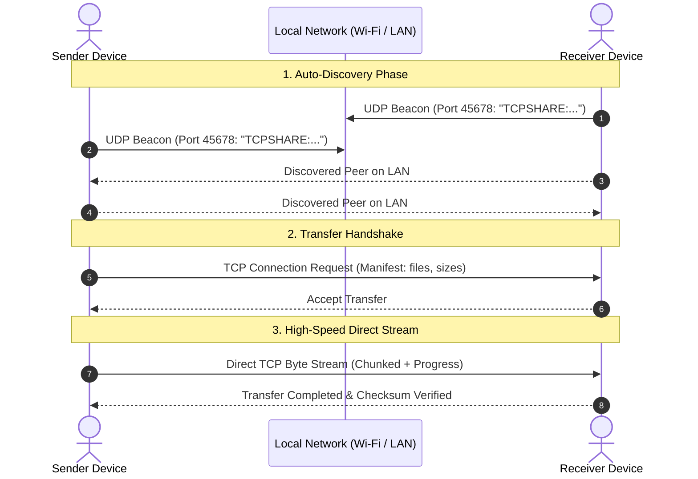

<div align="center">


# LocalShare

**High-speed, peer-to-peer LAN file sharing — fast, private, and serverless.**

[](https://flutter.dev)
[](https://dart.dev)
[](#supported-platforms)
[](#supported-platforms)
[](#supported-platforms)
[](LICENSE)

[Features](#-features) • [How It Works](#-how-it-works) • [Installation](#-installation--downloads) • [Building from Source](#-building-from-source) • [Architecture](#-architecture) • [Security & Privacy](#-security--privacy)

</div>

---

## ⚡ Overview

**LocalShare** is an open-source, cross-platform file transfer application built with Flutter. It lets you send and receive files, folders, photos, and media between devices on the same Wi-Fi or Local Area Network (LAN) at full network hardware speed.

- **No cloud servers.** Files transfer directly from device to device.
- **No file size caps.** Share anything from small documents to massive multi-gigabyte video libraries.
- **No account required.** Zero logins, zero trackers, 100% offline-ready.

---

## ✨ Features

- 🚀 **Blazing-Fast Direct TCP Streaming:** Bypasses intermediate relays and cloud throttles to transfer at maximum LAN wire/Wi-Fi speed.
- 📡 **Zero-Config LAN Auto-Discovery:** Devices automatically discover each other on the local network using lightweight UDP broadcast beacons (Port 45678).
- 🖱️ **Desktop Drag & Drop:** Drop files or folders directly into the app window on macOS and Windows to instantly initiate a transfer.
- 🦸 **Fun & Unique Device Names:** Every device generates a memorable, deterministic superhero or anime codename (e.g., *Iron Man*, *Thor*, *Wonder Woman*), or can be renamed anytime.
- 🎨 **Adaptive Modern Design:** Polished Material 3 user experience with full Dark / Light mode switching, Google Fonts typography, and fluid micro-animations.
- 📊 **Transfer Queue & History:** Monitor real-time transfer speeds, pause/resume indicators, progress percentages, and review completed transfer logs.
- 🖼️ **Media Gallery Integration:** Automatic sorting for images, videos, audio, and documents with auto-saving to system gallery and Downloads folder.

---

## 🛠️ How It Works



---

## 📱 Supported Platforms

| Platform | Status | Distribution Formats |
|:---|:---:|:---|
| **macOS** | ✅ Fully Supported | `.dmg` Installer, `.app` bundle |
| **Android** | ✅ Fully Supported | `.apk` |
| **Windows** | ✅ Supported | `.msix`, portable installer |
| **iOS** | 🔄 In Progress | App Store / TestFlight |

---

## 📦 Installation & Downloads

### macOS Installation
1. Download the latest **`LocalShare.dmg`** from [Releases](https://github.com/AyushSonewane/localshare_ios/releases).
2. Double-click the `.dmg` file to open the installer.
3. Drag **LocalShare** into your **Applications** folder.
4. Launch LocalShare from Spotlight (`Cmd + Space`) or Launchpad.

---

## 🏗️ Building from Source

### Prerequisites
- [Flutter SDK](https://flutter.dev/docs/get-started/install) (`>= 3.24.0` recommended)
- [Dart SDK](https://dart.dev/get-dart) (`>= 3.0.0 < 4.0.0`)
- **macOS:** Xcode 15+ and CocoaPods (`gem install cocoapods`)
- **Android:** Android Studio & Android SDK
- **Windows:** Visual Studio 2022 with Desktop development with C++

### 1. Clone the Repository
```bash
git clone https://github.com/AyushSonewane/localshare_ios.git
cd localshare_ios
```

### 2. Install Dependencies
```bash
flutter pub get
```

### 3. Generate Platform Launch Icons (Optional)
```bash
dart run flutter_launcher_icons
```

### 4. Run Locally

```bash
# Run on macOS
flutter run -d macos

# Run on Android
flutter run -d android

# Run on Windows
flutter run -d windows
```

### 5. Build Release Bundles

#### macOS
```bash
flutter build macos --release
```
The compiled application is generated at:
`build/macos/Build/Products/Release/LocalShare.app`

To package a standalone `.dmg`:
```bash
mkdir -p build/dmg_staging
cp -R build/macos/Build/Products/Release/LocalShare.app build/dmg_staging/
ln -s /Applications build/dmg_staging/Applications
hdiutil create -volname "LocalShare" -srcfolder build/dmg_staging -ov -format UDZO build/LocalShare.dmg
rm -rf build/dmg_staging
```

#### Android
```bash
flutter build apk --release
```

#### Windows
```bash
flutter build windows --release
```

---

## 📂 Project Architecture

```
localshare_ios/
├── assets/
│   ├── animations/          # Lottie vector motion assets
│   └── images/              # Logo variants and brand assets
├── lib/
│   ├── main.dart            # App entrypoint and provider injection
│   ├── models/              # DeviceInfo, FileSource, TransferItem
│   ├── screens/             # Home, Send, Receive, History, Settings
│   ├── services/
│   │   ├── discovery_service.dart     # UDP broadcast beaconing & peer tracking
│   │   ├── file_transfer_service.dart # Stream orchestration & batch processing
│   │   ├── settings_service.dart      # User preferences & persistent storage
│   │   ├── share_intent_service.dart  # Native OS share sheet receivers
│   │   └── tcp_service.dart           # Raw TCP socket client/server pipeline
│   ├── theme/               # Light/Dark Material 3 color palettes
│   ├── utils/               # Character name generator, formatters
│   └── widgets/             # Reusable UI components & dialogs
├── macos/                   # Native macOS Xcode workspace & entitlements
├── android/                 # Native Android gradle wrapper & manifest
└── pubspec.yaml             # Dependencies and build configuration
```

---

## 🔒 Security & Privacy

- **100% On-Device & Offline:** LocalShare never connects to an external server or telemetry collector.
- **Isolated Peer-to-Peer:** Data stays entirely within your local subnet.
- **Explicit Consent:** Every incoming transfer requires user approval with file preview and sender information before any bytes are written to disk.

---

## 🤝 Contributing

Contributions, feature requests, and bug reports are welcome!

1. Fork the Project
2. Create your Feature Branch (`git checkout -b feature/AmazingFeature`)
3. Commit your Changes (`git commit -m 'Add some AmazingFeature'`)
4. Push to the Branch (`git push origin feature/AmazingFeature`)
5. Open a Pull Request

---

## 📄 License

Distributed under the MIT License. See `LICENSE` for more information.

---

<div align="center">
Built with ❤️ by <a href="https://github.com/AyushSonewane">Ayush Sonewane</a>
</div>
